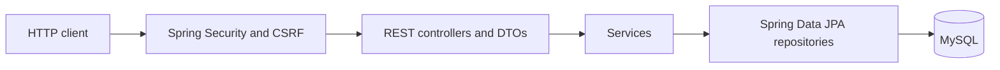
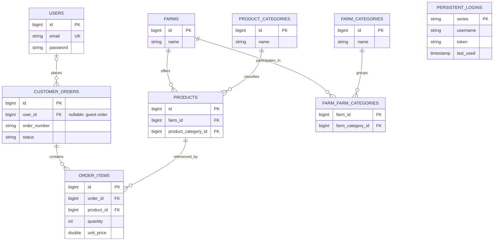

# Architecture and Data

## Layers

| Package | Responsibility |
|---|---|
| `controllers` | HTTP contract and request validation |
| `dtos` | Input and output data |
| `services` | Authentication, catalog, and orders |
| `repositories` | Queries and JPA persistence |
| `entities` | Persistent model |
| `config` | Security and remember-me configuration |
| `seeders` | Initial loading and optional size updates |
| `exceptions` | Application errors and handled responses |

## Relational Model

The diagram summarizes relationships. It is not a complete DDL with every type and constraint.

`customer_orders.user_id` is nullable for guest orders: each order has zero or one user. `persistent_logins.username` uses the authentication identifier, but `schema.sql` does not declare a foreign key to `users`.

Farm and product categories are independent tables. A producer's category does not automatically determine the category of every product it sells.

## Initial Data

`farmers.json` uses `externalId` to link products in `products.json` through `farmExternalId`. Numeric MySQL IDs are generated during insertion and are not stable across different databases.

The documented revision contains 68 farms and 337 products. Demonstration users are not created automatically.

`DataSeeder` skips catalog seeding if any farms or products already exist. If one table has data and the other does not, it does not automatically repair that partial load.

The optional `app.data.fill-product-sizes=true` mode attempts to fill missing sizes by matching product name and producer. It is not general synchronization and does not update categories or images.

## Catalog Changes

1. Correct JSON and check that unrelated fields are unchanged.
2. Create and verify a backup of the existing database.
3. Identify records by producer and product, not just a word in the name.
4. Apply a reviewed, transactional update of the required fields.
5. Compare API and JSON results, and verify that users and orders were preserved.

Do not delete or recreate tables to update a category or image. Local scripts in `target/` are temporary tools for one installation, not portable migrations for other databases.

## Current Model Limitations

- Prices and amounts use `Double`; commercial use needs a decimal money model and explicit rounding rules.
- Lines store quantity and price, but order details read name and image from the related product: there is no complete historical catalog snapshot.
- Saving orders does not reserve or deduct stock.
- Order numbers use the current time in milliseconds; the strategy needs strengthening for concurrent use.
