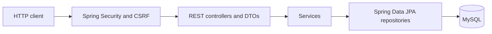
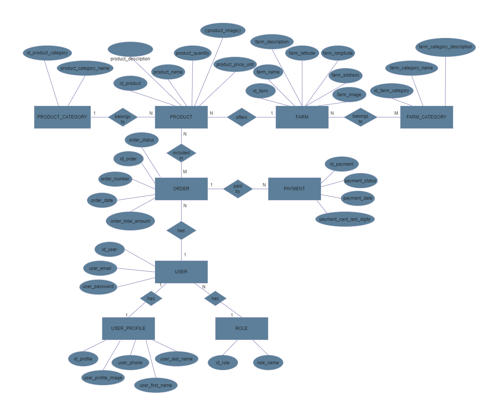
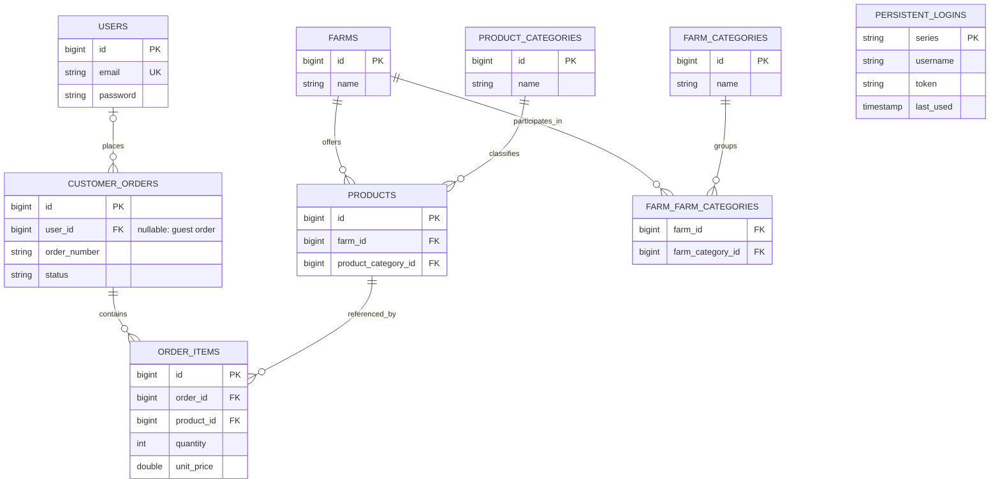
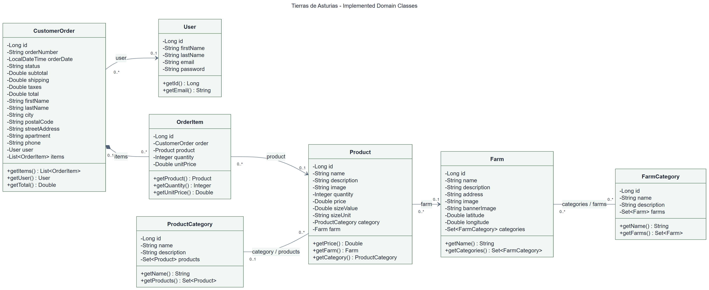
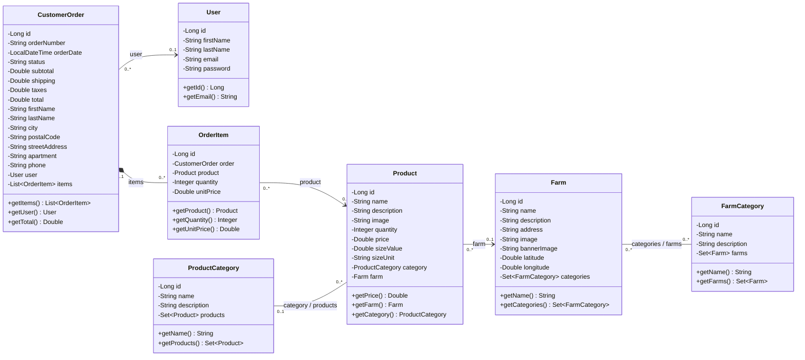

# Architecture and Data

## Layers

| Package | Responsibility |
|---|---|
| `controllers` | HTTP contract and request validation |
| `dtos` | Input and output data |
| `services` | Authentication, catalog, and orders |
| `repositories` | Queries and JPA persistence |
| `entities` | Persistent model |
| `config` | Security and remember-me configuration |
| `seeders` | Initial loading and optional size updates |
| `exceptions` | Application errors and handled responses |

## Planned Data Model

The following diagram is the author's original target model for the complete application, including future development. It is preserved in full; it does not claim that every entity is implemented in the current PMV.

[Open the full-size planned diagram](../images/planned-data-model.png).

| Area | Planned model | Current PMV |
|---|---|---|
| Payments | Separate `PAYMENT` entity | No payment processing or payment table |
| Customer profile | Separate `USER_PROFILE` entity | First and last names are stored in `users`; delivery details belong to each order |
| Roles | Separate `ROLE` entity | Spring Security currently assigns the `CUSTOMER` authority in code |
| Order lines | Conceptual many-to-many product/order relationship | `order_items` stores the product, quantity and unit price |
| Guest checkout | User/order relationship shown in the target model | `customer_orders.user_id` may be null for guest orders |

The implemented database and domain classes are documented separately below. Planned entities do not need to be removed from this target design.

## Relational Model

This diagram summarizes the implemented database relationships. It is not a complete DDL with every type and constraint.

`customer_orders.user_id` is nullable for guest orders: each order has zero or one user. `persistent_logins.username` uses the authentication identifier, but `schema.sql` does not declare a foreign key to `users`.

Farm and product categories are independent tables. A producer's category does not automatically determine the category of every product it sells.

## Domain Class Diagram

This UML diagram shows the seven implemented JPA entity classes, their attributes, selected public methods, and associations. It is a domain-model view, not an inventory of every controller, service, DTO or framework class.

[Full-size PNG](../images/class-diagram.png) | [Scalable SVG](../images/class-diagram.svg) | [Editable Mermaid source](../diagrams/class-diagram.mmd)

The exports were prepared on 2026-10-28 after checking the fields and methods in `src/main/java/com/tierrasdeasturias/backend/entities/`. Names and Java types follow the source code; only selected getters are shown to keep the diagram readable. The `.mmd` source can be edited and rendered with [Mermaid](https://mermaid.js.org/syntax/classDiagram.html).

Alternative Mermaid rendering

`-` marks private fields and `+` marks public methods. `Set~T~` and `List~T~` represent Java generic collections.

The optional `0..1` ends reflect nullable references in the current JPA mappings, including guest orders. The order/items composition represents cascading persistence and orphan removal. The order-creation DTO separately requires at least one item and the service resolves its product from the database.

`persistent_logins` is managed by Spring Security's JDBC token repository, not a project JPA entity. `PAYMENT`, `USER_PROFILE` and `ROLE` remain part of the planned model above, not implemented entity classes. The `User.password` field contains a password hash, not a plain-text password.

## Initial Data

`farmers.json` uses `externalId` to link products in `products.json` through `farmExternalId`. Numeric MySQL IDs are generated during insertion and are not stable across different databases.

The documented revision contains 68 farms and 337 products. Demonstration users are not created automatically.

`DataSeeder` skips catalog seeding if any farms or products already exist. If one table has data and the other does not, it does not automatically repair that partial load.

The optional `app.data.fill-product-sizes=true` mode attempts to fill missing sizes by matching product name and producer. It is not general synchronization and does not update categories or images.

## Catalog Changes

1. Correct JSON and check that unrelated fields are unchanged.
2. Create and verify a backup of the existing database.
3. Identify records by producer and product, not just a word in the name.
4. Apply a reviewed, transactional update of the required fields.
5. Compare API and JSON results, and verify that users and orders were preserved.

Do not delete or recreate tables to update a category or image. Local scripts in `target/` are temporary tools for one installation, not portable migrations for other databases.

## Current Model Limitations

- Prices and amounts use `Double`; commercial use needs a decimal money model and explicit rounding rules.
- Lines store quantity and price, but order details read name and image from the related product: there is no complete historical catalog snapshot.
- Saving orders does not reserve or deduct stock.
- Order numbers use the current time in milliseconds; the strategy needs strengthening for concurrent use.
