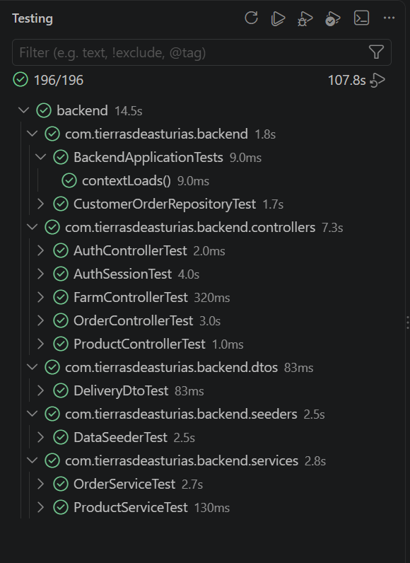
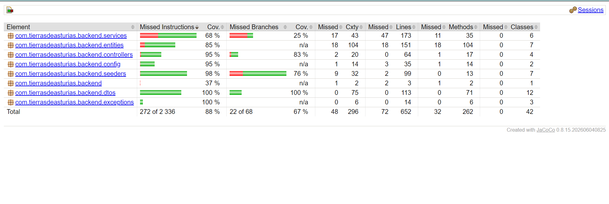

# Operations and Testing

## Startup and Health Checks

Configure `REMEMBER_ME_KEY`, start Docker, and run Maven Wrapper from the backend root. See the [README](../../README.md).

```bash
docker compose ps
docker compose port mysql 3306
docker compose logs --tail=30 mysql
curl http://localhost:8080/actuator/health
```

The host port is dynamic. Do not copy another installation's port or include secrets in configuration screenshots.

## Persistence

The `mysql-data` volume holds the database. Stopping the container does not delete its data. Deleting volumes can lose users and orders; it is not a mechanism for applying JSON changes.

## Backups

Example for Git Bash, run from the backend directory. It writes outside the repository, into a private sibling directory:

```bash
mkdir -p ../backups
backup="../backups/tierras-$(date +%Y%m%d-%H%M%S).sql"
docker compose exec -T mysql sh -c 'MYSQL_PWD="$MYSQL_ROOT_PASSWORD" mysqldump -u root --single-transaction --no-tablespaces --set-gtid-purged=OFF --default-character-set=utf8mb4 "$MYSQL_DATABASE"' > "$backup"
echo $?
ls -lh "$backup"
tail -n 2 "$backup"
```

Check for exit code 0, a nonempty file, and the dump completion marker. These checks do not replace a restore test in a separate database.

Dumps contain private information. Do not upload them to Git, Jira, or the Wiki. Do not restore over the working database without reviewing the destination, backup date, and recovery plan.

## Testing

Stop the development application first to prevent DevTools from reloading classes during compilation.

PowerShell:

```powershell
.\mvnw.cmd "-Dspring.docker.compose.enabled=false" test
```

Git Bash:

```bash
./mvnw -Dspring.docker.compose.enabled=false test
```

- Services: rules and mappings using test doubles.
- Controllers: MockMvc, validation, CSRF, and authorization.
- Sessions: login, remember-me login, and logout.
- Seeder: catalog fields, images, and sizes.
- Repositories and application context: MySQL through Testcontainers.

Testcontainers tests require Docker and may download `mysql:8.4`. Do not replace their connections with the working database connection: some tests use `create-drop`.

Reports and artifacts:

| File or Directory | Content |
|---|---|
| `target/surefire-reports/` | Test results |
| `target/site/jacoco/index.html` | JaCoCo coverage |
| `target/backend-0.0.1-SNAPSHOT.jar` | Packaged application after `package` |

### Supplied Test Results

The following screenshots were supplied on 2026-10-28. They are evidence of the results displayed, not a fresh Maven run performed while writing this page. Open an image to view it at full resolution.

The VS Code test summary shows **196 passing tests out of 196**. The visible groups include application context, repository, controller, session, DTO, seeder, and service tests.

[](../images/backend-tests.png)

### Supplied Coverage Report

The supplied JaCoCo screenshot records these overall results:

| Metric | Coverage |
|---|---:|
| Instructions | 88% |
| Branches | 67% |

[](../images/backend-coverage.png)

Instruction coverage is not line coverage. The screenshots do not establish that the test summary and coverage report come from the same run. After code changes, rerun the Maven command above and check the generated reports before claiming current results.

## Troubleshooting

| Symptom | Check |
|---|---|
| `REMEMBER_ME_KEY` cannot be resolved | Java process environment; VS Code may not inherit the terminal |
| MySQL connection fails | Docker, container, published port, and selected configuration |
| CSRF returns 403 | Fetch a current token, retain cookies, and use the same host |
| Login returns 401 | Credentials and prior user registration |
| JSON changes do not appear | Existing records are not synchronized on restart |
| Order is absent from profile | It may have been placed as a guest or under another account |
| An order returns 404 | ID does not exist or is not owned by the authenticated user |
| Integration fails before tests start | Docker or Testcontainers image download/startup |

## Deployment

Hosting, HTTPS, frontend origin, proxy, secrets, migrations, tested restoration, and monitoring remain to be defined. Compose credentials and `ddl-auto=update` are not a production configuration.
